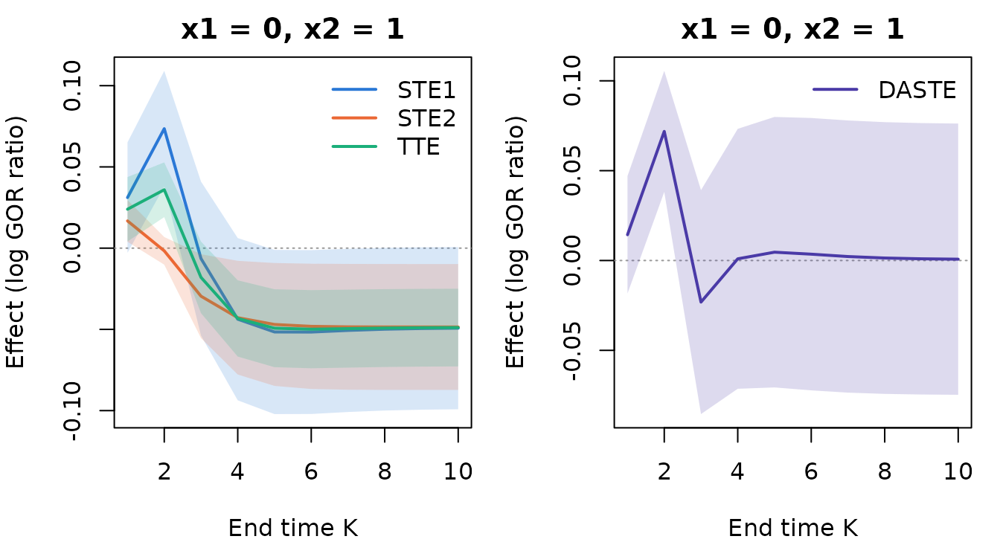

# Getting started with BiSCaL

`BiSCaL` estimates and tests **separable causal treatment effects** on
two ordinal (including binary) responses that are measured repeatedly in
a longitudinal study, following Hu and Yi (2026). This vignette
introduces the framework and walks through an analysis of the simulated
trial `simtrial` that ships with the package.

``` r

library(BiSCaL)
```

## The framework in brief

Subjects are randomized to a treatment A \in \\0, 1\\ and followed at
visits k = 0, 1, \dots, K, where two responses Y\_{1,k} and Y\_{2,k} are
recorded, Y\_{1,k} before Y\_{2,k}. In the motivating Lipid Research
Clinics Coronary Primary Prevention Trial, Y\_{1,k} indicates high HDL
cholesterol and Y\_{2,k} low LDL cholesterol. The two responses
influence each other over time and depend on baseline covariates X.

The treatment is conceptualized as having two components: A_1, which
acts on the first response, and A_2, which acts on the second (A = a
corresponds to A_1 = A_2 = a). The effects are defined at the end time
point K through the **generalized odds ratio** of the two responses
under (A_1, A_2) = (a_1, a_2), given X = x:

GOR_K(a_1, a_2) = \frac{P(Y_1 \le y_1, Y_2 \le y_2)\\ P(Y_1 \> y_1, Y_2
\> y_2)} {P(Y_1 \le y_1, Y_2 \> y_2)\\ P(Y_1 \> y_1, Y_2 \le y_2)},

where Y_j = Y\_{j,K}(a_1, a_2) are counterfactual responses and y_1, y_2
are thresholds (for binary responses, y_1 = y_2 = 0). A positive \log
GOR means that the two responses tend to fall on the same side of their
thresholds. Then

- the **total treatment effect** is TTE_K = \log\\GOR_K(1,1) /
  GOR_K(0,0)\\;
- the **separable treatment effect** on response 1 changes only the
  component acting on it: STE\_{1,K} = \log\\GOR_K(1,1)/GOR_K(0,1)\\ +
  \log\\GOR_K(1,0)/GOR_K(0,0)\\, and STE\_{2,K} is defined
  symmetrically;
- by Theorem 1 of the paper, STE\_{1,K} + STE\_{2,K} = 2\\TTE_K.

The arms (1, 0) and (0, 1) are never observed. They are identified under
conditional exchangeability, consistency, positivity and a condition on
the treatment components (Conditions 1–4 of the paper). The
identification is a recursive formula in the transition probabilities of
the responses. `BiSCaL` models these probabilities with
baseline-category logistic regressions, estimates them by maximum
likelihood (allowing for intermittent missingness and censoring), and
propagates them through the recursion.

The quantity used to compare the two responses is the difference of the
**absolute separable treatment effects**, DASTE_K = \|STE\_{1,K}\| -
\|STE\_{2,K}\|. A negative value means that the treatment affects the
second response more than the first.

## The data

`simtrial` is a simulated trial with 1000 subjects, a baseline visit and
ten follow-up visits. It has two binary responses, a continuous
covariate `x1` and a binary covariate `x2`. The data are in long format,
one row per subject and recorded visit:

``` r

head(simtrial, 12)
#>    id visit trt     x1 x2 y1 y2
#> 1   1     0   0  0.521  1  0  1
#> 2   1     1   0  0.521  1  1  1
#> 3   1     2   0  0.521  1  1  1
#> 4   1     3   0  0.521  1  1 NA
#> 5   1     4   0  0.521  1  1  1
#> 6   1     5   0  0.521  1  1  1
#> 7   1     6   0  0.521  1  1  1
#> 8   1     7   0  0.521  1  0  1
#> 9   1     8   0  0.521  1 NA  1
#> 10  1     9   0  0.521  1  1  1
#> 11  2     0   0 -1.080  0  0  0
#> 12  2     1   0 -1.080  0  0  0
```

Missing responses are coded `NA` (intermittent missingness). Subjects
are followed until a censoring visit, after which they have no rows:

``` r

table(simtrial$visit)
#> 
#>    0    1    2    3    4    5    6    7    8    9   10 
#> 1000  998  993  987  965  927  858  772  623  439  207
```

The visit index must be `0` at baseline and `1, 2, ...` at the scheduled
follow-up visits. The treatment and covariates must be constant within
subjects.

## Fitting the models

[`biscal()`](https://pingbohu43.github.io/BiSCaL/reference/biscal.md)
fits four regression models by maximum likelihood:

- a transition model for each response, models (12) of the paper;
- a baseline model for each response, models (13) and (14).

The left-hand side of the formula lists the two responses, the one
measured first at each visit first. The right-hand side lists the
baseline covariates.

``` r

fit <- biscal(cbind(y1, y2) ~ x1 + x2, data = simtrial, id = "id",
              time = "visit", treatment = "trt")
fit
#> Separable treatment effects for longitudinal bivariate responses (BiSCaL)
#> 
#> Call:
#> biscal(formula = cbind(y1, y2) ~ x1 + x2, data = simtrial, id = "id", 
#>     time = "visit", treatment = "trt")
#> 
#> Subjects: 1000 (treated 500, control 500); visits 0 to 10 (K = 10)
#> Treatment: trt (control = 0, treated = 1)
#> Responses: y1 [0 < 1] then y2 [0 < 1]
#> Follow-up: mean last visit 7.77; missing after baseline: y1 20.9%, y2 14.2%
#> Observations used: transitions y1 4511, y2 4700; baseline y1 1000, y2 1000
#> Log-likelihood: -4792.67 (df = 19)
#> 
#> Coefficients:
#> Transition model for y1 (model (12), j = 1):
#> (Intercept)   y1[k-1]=1   y2[k-1]=1         trt          x1          x2 
#>     -0.5762      1.5984      1.1999      1.6199      0.4017     -0.5472 
#> Transition model for y2 (model (12), j = 2):
#> (Intercept)     y1[k]=1   y2[k-1]=1         trt          x1          x2 
#>    -0.45450     0.88056     1.57409     0.22577     0.26392     0.08216 
#> Baseline model for y1 (model (13)):
#> (Intercept)          x1          x2 
#>    -0.05444     0.47013    -0.24870 
#> Baseline model for y2 (model (14)):
#> (Intercept)     y1[0]=1          x1          x2 
#>     -0.0786      0.9546      0.4048      0.3028
```

A transition of the first response at visit k enters the likelihood when
Y\_{1,k}, Y\_{1,k-1} and Y\_{2,k-1} are all observed. A transition of
the second response enters when Y\_{2,k}, Y\_{2,k-1} and Y\_{1,k} are
observed (Section 4.2 of the paper).
[`summary()`](https://rdrr.io/r/base/summary.html) gives the coefficient
tables, in the format of Table 1 of the paper:

``` r

summary(fit)
#> Separable treatment effects for longitudinal bivariate responses (BiSCaL)
#> 
#> Call:
#> biscal(formula = cbind(y1, y2) ~ x1 + x2, data = simtrial, id = "id", 
#>     time = "visit", treatment = "trt")
#> 
#> Subjects: 1000 (treated 500, control 500); visits 0 to 10 (K = 10)
#> Treatment: trt (control = 0, treated = 1)
#> Responses: y1 [0 < 1] then y2 [0 < 1]
#> Follow-up: mean last visit 7.77; missing after baseline: y1 20.9%, y2 14.2%
#> Observations used: transitions y1 4511, y2 4700; baseline y1 1000, y2 1000
#> Log-likelihood: -4792.67 (df = 19)
#> 
#> Transition model for y1 (model (12), j = 1):
#>             Estimate Std. Error z value Pr(>|z|)    
#> (Intercept) -0.57617    0.10007  -5.758 8.54e-09 ***
#> y1[k-1]=1    1.59836    0.09456  16.903  < 2e-16 ***
#> y2[k-1]=1    1.19990    0.09775  12.275  < 2e-16 ***
#> trt          1.61990    0.10569  15.327  < 2e-16 ***
#> x1           0.40168    0.05598   7.176 7.19e-13 ***
#> x2          -0.54721    0.09368  -5.842 5.17e-09 ***
#> ---
#> Signif. codes:  0 '***' 0.001 '**' 0.01 '*' 0.05 '.' 0.1 ' ' 1
#> 
#> Transition model for y2 (model (12), j = 2):
#>             Estimate Std. Error z value Pr(>|z|)    
#> (Intercept) -0.45450    0.09783  -4.646 3.39e-06 ***
#> y1[k]=1      0.88056    0.09867   8.924  < 2e-16 ***
#> y2[k-1]=1    1.57409    0.08364  18.821  < 2e-16 ***
#> trt          0.22577    0.08574   2.633  0.00846 ** 
#> x1           0.26392    0.04791   5.509 3.61e-08 ***
#> x2           0.08216    0.08254   0.995  0.31953    
#> ---
#> Signif. codes:  0 '***' 0.001 '**' 0.01 '*' 0.05 '.' 0.1 ' ' 1
#> 
#> Baseline model for y1 (model (13)):
#>             Estimate Std. Error z value Pr(>|z|)    
#> (Intercept) -0.05444    0.08375  -0.650   0.5157    
#> x1           0.47013    0.06911   6.803 1.03e-11 ***
#> x2          -0.24870    0.13322  -1.867   0.0619 .  
#> ---
#> Signif. codes:  0 '***' 0.001 '**' 0.01 '*' 0.05 '.' 0.1 ' ' 1
#> 
#> Baseline model for y2 (model (14)):
#>             Estimate Std. Error z value Pr(>|z|)    
#> (Intercept) -0.07860    0.10735  -0.732   0.4640    
#> y1[0]=1      0.95459    0.14091   6.774 1.25e-11 ***
#> x1           0.40480    0.07319   5.531 3.19e-08 ***
#> x2           0.30276    0.14049   2.155   0.0312 *  
#> ---
#> Signif. codes:  0 '***' 0.001 '**' 0.01 '*' 0.05 '.' 0.1 ' ' 1
```

The treatment raises the chance of a high value of the first response
considerably (coefficient 1.62), and of the second only slightly (0.23).
Each response also depends strongly on its own previous value and on the
other response.

## Effects for given covariate values

[`aste()`](https://pingbohu43.github.io/BiSCaL/reference/aste.md)
estimates the effects for covariate profiles supplied in `newdata`. It
computes delta-method standard errors and tests H_0: DASTE_K \ge 0
against H_1: DASTE_K \< 0 (Section 3.2.1 of the paper). As in Table 2 of
the paper, we take the smallest and the largest value of each covariate:

``` r

profiles <- data.frame(x1 = range(simtrial$x1), x2 = c(0, 1))
ind <- aste(fit, newdata = profiles)
ind
#> Separable treatment effects given covariate values (individual level)
#> Thresholds: y1 <= 0, y2 <= 0; Wald 95% confidence intervals
#> 
#> Profile 1 (x1 = -3.048, x2 = 0), end time K = 10:
#>        Estimate Std. Error Lower 95% Upper 95%
#> STE1   -0.03274    0.01746  -0.06697  0.001492
#> STE2  -0.003669   0.009454  -0.02220   0.01486
#> TTE    -0.01820   0.008200  -0.03428 -0.002131
#> ASTE1   0.03274    0.01746 -0.001492   0.06697
#> ASTE2  0.003669   0.009454  -0.01486   0.02220
#> DASTE   0.02907    0.02280  -0.01562   0.07375
#> H0: DASTE >= 0 vs H1: DASTE < 0: z = 1.275, p-value = 0.899
#> 
#> Profile 2 (x1 = 3.416, x2 = 1), end time K = 10:
#>        Estimate Std. Error Lower 95% Upper 95%
#> STE1   -0.05311    0.01549  -0.08347  -0.02275
#> STE2   -0.05587    0.02281   -0.1006  -0.01116
#> TTE    -0.05449    0.01123  -0.07650  -0.03248
#> ASTE1   0.05311    0.01549   0.02275   0.08347
#> ASTE2   0.05587    0.02281   0.01116    0.1006
#> DASTE -0.002758    0.03187  -0.06523   0.05971
#> H0: DASTE >= 0 vs H1: DASTE < 0: z = -0.08654, p-value = 0.466
```

A negative separable effect means that the corresponding treatment
component lowers the log generalized odds ratio. All estimated
generalized odds ratios here exceed one (see below), so a negative
effect weakens the positive association of the two responses at the last
visit.

- For the smallest covariate values, STE_1 is estimated at -0.033, but
  its confidence interval includes zero.
- For the largest values, STE_1 (-0.053) and STE_2 (-0.056) are both
  negative and of similar size.

The test of the paper, whose alternative is that the treatment affects
the second response more, is far from significant for both profiles (p =
0.9 and 0.47). The opposite direction can be tested with
`alternative = "greater"`:

``` r

aste(fit, newdata = profiles, alternative = "greater")$test
#>   profile  K     estimate  std.error  statistic   p.value
#> 1       1 10  0.029067906 0.02279804  1.2750175 0.1011515
#> 2       2 10 -0.002758293 0.03187198 -0.0865429 0.5344826
```

The results are also available as data frames, together with the
underlying generalized odds ratios:

``` r

head(as.data.frame(ind))
#>   profile  K effect     estimate   std.error     conf.low    conf.high
#> 1       1 10   STE1 -0.032736899 0.017463825 -0.066965366  0.001491568
#> 2       1 10   STE2 -0.003668993 0.009454170 -0.022198826  0.014860841
#> 3       1 10    TTE -0.018202946 0.008200338 -0.034275313 -0.002130578
#> 4       1 10  ASTE1  0.032736899 0.017463825 -0.001491568  0.066965366
#> 5       1 10  ASTE2  0.003668993 0.009454170 -0.014860841  0.022198826
#> 6       1 10  DASTE  0.029067906 0.022798044 -0.015615440  0.073751252
as.data.frame(ind, what = "gor")[1:4, ]
#>   profile  K a1 a2      gor
#> 1       1 10  1  1 3.665858
#> 2       1 10  1  0 3.664201
#> 3       1 10  0  1 3.717846
#> 4       1 10  0  0 3.733198
```

## Effects over follow-up

A vector `K` gives the effects at several end time points. Their curves
show how the effects build up over the visits:

``` r

path <- aste(fit, newdata = data.frame(x1 = 0, x2 = 1), K = 1:10)
op <- par(mfrow = c(1, 2), mar = c(4, 4, 2, 1))
plot(path)
plot(path, effects = "DASTE")
```



``` r

par(op)
```

The effects change over the first few visits and then stabilize, as the
transitions settle into their long-run behavior.

## Population-level effects

[`easte()`](https://pingbohu43.github.io/BiSCaL/reference/easte.md)
averages the effects over a distribution of the covariates. It estimates
the expected absolute separable treatment effects EASTE\_{j,K} =
E\|STE\_{j,K}(X)\| and their difference DEASTE_K, with a Wald test
(Section 3.2.2 of the paper). By default, the average is over the
covariates of the subjects in the data. The standard errors then include
the sampling variability of the covariates.

``` r

pop <- easte(fit)
pop
#> Separable treatment effects averaged over covariates (population level)
#> Average over 1000 rows of the covariates of the fitted data
#> Thresholds: y1 <= 0, y2 <= 0; Wald 95% confidence intervals
#> Standard errors include the sampling variability of the covariates
#> 
#> End time K = 10:
#>        Estimate Std. Error Lower 95% Upper 95%
#> ESTE1  -0.06862    0.02125   -0.1103  -0.02696
#> ESTE2  -0.04283    0.01739  -0.07691 -0.008757
#> ETTE   -0.05573    0.01040  -0.07612  -0.03534
#> EASTE1  0.06868    0.02122   0.02710    0.1103
#> EASTE2  0.04283    0.01739  0.008757   0.07691
#> DEASTE  0.02585    0.03276  -0.03835   0.09005
#> H0: DEASTE >= 0 vs H1: DEASTE < 0: z = 0.7892, p-value = 0.785
```

Averaged over the participants, both separable effects are negative: the
treatment weakens the (positive) association of the two responses
through both of its components. The weakening is stronger through the
component acting on the first response (EASTE_1 = 0.069 against EASTE_2
= 0.043). The difference is not statistically significant (two-sided
p-value 0.43).

The paper instead averages over a large number of draws from a model for
the covariate distribution: a Gaussian mixture for the continuous
covariates within groups defined by the discrete ones. Any such model
can be used by passing the draws as `newdata`. Here is a simple version,
with `x2` drawn from its observed frequency and `x1` from a normal
distribution within each level of `x2`:

``` r

base <- unique(simtrial[, c("id", "x1", "x2")])
set.seed(1)
M <- 5000
x2 <- rbinom(M, 1, mean(base$x2))
mu <- tapply(base$x1, base$x2, mean)
sdev <- tapply(base$x1, base$x2, sd)
draws <- data.frame(x1 = rnorm(M, mu[x2 + 1], sdev[x2 + 1]), x2 = x2)
easte(fit, newdata = draws)$effects
#>    K effect    estimate  std.error     conf.low    conf.high        mc_se
#> 1 10  ESTE1 -0.06892773 0.02116115 -0.110402822 -0.027452645 0.0003090721
#> 2 10  ESTE2 -0.04267381 0.01731911 -0.076618651 -0.008728968 0.0001262015
#> 3 10   ETTE -0.05580077 0.01035888 -0.076103795 -0.035497747 0.0001717064
#> 4 10 EASTE1  0.06899596 0.02108905  0.027662179  0.110329740 0.0003060117
#> 5 10 EASTE2  0.04267643 0.01732027  0.008729326  0.076623541 0.0001260239
#> 6 10 DEASTE  0.02631953 0.03259096 -0.037557583  0.090196636 0.0003222379
```

With supplied draws, the standard errors treat the covariate
distribution as known, as in the authors’ implementation. The variance
formula of the paper also includes the uncertainty of the estimated
covariate model, which is therefore not reflected here. The column
`mc_se` gives the Monte Carlo error of the average.

## Counterfactual distributions

[`cf_prob()`](https://pingbohu43.github.io/BiSCaL/reference/cf_prob.md)
returns the joint distribution of the two responses under any
combination of the treatment components, and
[`gor()`](https://pingbohu43.github.io/BiSCaL/reference/gor.md) the
generalized odds ratios:

``` r

pr <- cf_prob(fit, newdata = data.frame(x1 = 0, x2 = 1), a1 = 1, a2 = 0)
round(pr[1, , , 1], 3)
#>    y2
#> y1      0     1
#>   0 0.022 0.036
#>   1 0.141 0.801
gor(fit, newdata = data.frame(x1 = 0, x2 = 1), a1 = c(1, 1, 0, 0), a2 = c(1, 0, 1, 0))
#>   profile  K a1 a2      gor
#> 1       1 10  1  1 3.389511
#> 2       1 10  1  0 3.461436
#> 3       1 10  0  1 3.462722
#> 4       1 10  0  0 3.559347
```

## Ordinal responses

Responses with more than two ordered categories are handled in the same
way: models (12)–(14) become baseline-category logistic regressions,
with dummy codes of the previous responses. The thresholds `y1` and `y2`
choose where the responses are dichotomized in the generalized odds
ratio. To illustrate, we simulate three-category responses from
coefficient matrices with one column per non-reference category:

``` r

mk <- function(v, terms) matrix(v, ncol = 2, dimnames = list(terms, c("1", "2")))
co <- list(
  beta1 = mk(c(-0.5, 1.2, 2.0, 0.3, 0.5, 0.8, 0.4, -1.0, 0.8, 2.5, 0.2, 0.9, 0.2, 0.3),
             c("(Intercept)", "y1[k-1]=1", "y1[k-1]=2", "y2[k-1]=1", "y2[k-1]=2", "trt", "x")),
  beta2 = mk(c(-0.3, 0.5, 0.9, 1.5, 2.2, -0.4, 0.2, -0.8, 0.7, 1.4, 1.0, 2.8, 0.6, -0.2),
             c("(Intercept)", "y1[k]=1", "y1[k]=2", "y2[k-1]=1", "y2[k-1]=2", "trt", "x")),
  gamma1 = mk(c(0.2, 0.5, -0.3, 0.4), c("(Intercept)", "x")),
  gamma2 = mk(c(0.1, 0.8, 1.2, 0.3, -0.5, 0.4, 1.5, -0.2),
              c("(Intercept)", "y1[0]=1", "y1[0]=2", "x")))
d3 <- simulate_biscal(n = 2000, K = 5, coefs = co, missing = TRUE, seed = 1)
fit3 <- biscal(cbind(y1, y2) ~ x, data = d3, id = "id", time = "visit",
               treatment = "trt")
aste(fit3, newdata = data.frame(x = 0), y1 = 1, y2 = 0)
#> Separable treatment effects given covariate values (individual level)
#> Thresholds: y1 <= 1, y2 <= 0; Wald 95% confidence intervals
#> 
#> Profile 1 (x = 0), end time K = 5:
#>       Estimate Std. Error Lower 95% Upper 95%
#> STE1   -0.1909    0.07667   -0.3412  -0.04066
#> STE2    0.3889    0.09238    0.2078    0.5699
#> TTE    0.09897    0.05931  -0.01727    0.2152
#> ASTE1   0.1909    0.07667   0.04066    0.3412
#> ASTE2   0.3889    0.09238    0.2078    0.5699
#> DASTE  -0.1979     0.1186   -0.4304   0.03454
#> H0: DASTE >= 0 vs H1: DASTE < 0: z = -1.669, p-value = 0.0476
```

In this design, the two treatment components act in opposite directions:
STE_1 is negative and STE_2 positive, so the total effect is small.

## The LRC-CPPT analysis of the paper

The data of the Lipid Research Clinics Coronary Primary Prevention Trial
are available from BioLINCC
(<https://biolincc.nhlbi.nih.gov/studies/lrccppt/>) on request. They
cannot be distributed with the package, so the code below is not run
here. Suppose `cppt` holds the data in long format, prepared as
described in Section 5.1 of the paper. It has one row per subject and
visit, with `visit = 0` at the visit when the medication was dispensed,
the binary responses `hdl_high` (HDL at least 60 mg/dL) and `ldl_low`
(LDL below 130 mg/dL), the treatment `trt` and the eight baseline
covariates. The analyses of Tables 1 to 3 are then:

``` r

f <- cbind(hdl_high, ldl_low) ~ BMI + EDUC + EVDNK + EVSMK + PHYSA + PHYSB + RACE + V5AGE
fit <- biscal(f, data = cppt, id = "ID", time = "visit", treatment = "trt")
summary(fit)                                   # Table 1

# Table 2: smallest and largest value of each covariate (Situations 1 and 2)
covs <- fit$covariate_data
situations <- as.data.frame(rbind(sapply(covs, min), sapply(covs, max)))
aste(fit, newdata = situations)

# Table 3: within a group defined by the discrete covariates, a Gaussian
# mixture for (BMI, V5AGE), here with two components
library(mixtools)
grp <- with(covs, EDUC == 0 & EVDNK == 1 & EVSMK == 1 & PHYSA == 0 & PHYSB == 0 &
                  RACE == 1)
set.seed(1)
gm <- mvnormalmixEM(as.matrix(covs[grp, c("BMI", "V5AGE")]), k = 2)
rgmm <- function(M, gm) {     # draws from the fitted mixture
  comp <- sample(length(gm$lambda), M, replace = TRUE, prob = gm$lambda)
  out <- matrix(NA_real_, M, length(gm$mu[[1]]))
  for (j in seq_along(gm$lambda)) {
    idx <- which(comp == j)
    z <- matrix(rnorm(length(idx) * ncol(out)), ncol = ncol(out))
    out[idx, ] <- sweep(z %*% chol(gm$sigma[[j]]), 2, gm$mu[[j]], "+")
  }
  out
}
xy <- rgmm(100000, gm)
draws <- data.frame(BMI = xy[, 1], EDUC = 0, EVDNK = 1, EVSMK = 1, PHYSA = 0,
                    PHYSB = 0, RACE = 1, V5AGE = xy[, 2])
easte(fit, newdata = draws)
```

## Practical notes

- **Assumptions.** The causal interpretation rests on Conditions 1–4 of
  the paper. Validity under missingness and censoring rests on
  Conditions AC1 and AC2: given the treatment, the covariates and the
  previous responses, censoring and missingness carry no further
  information about the current response. Condition 4 concerns the
  treatment components and cannot be tested when only the combined
  treatment is given.
- **Time homogeneity.** The transition models are common to all visits,
  so the visits should be equally spaced (or at least have comparable
  dynamics).
- **Separation.** Binary or ordinal regressions can separate: a category
  may be (almost) perfectly predicted, for example a baseline response
  that is nearly constant because of inclusion criteria.
  [`biscal()`](https://pingbohu43.github.io/BiSCaL/reference/biscal.md)
  then warns about very large standard errors. The affected
  probabilities are estimated as practically 0 or 1.
- **Standard errors** use the delta method of the paper, with numerical
  derivatives as in the authors’ implementation. The absolute values in
  ASTE are differentiated through the sign of STE, so tests of DASTE are
  unreliable when an STE is close to zero relative to its standard
  error.

## Reference

Hu, P. and Yi, G. Y. (2026). Inference about separable causal effects
with longitudinal bivariate ordinal responses with missingness and
censoring. *Statistics in Medicine*, 45, e70320.
<https://doi.org/10.1002/sim.70320>
