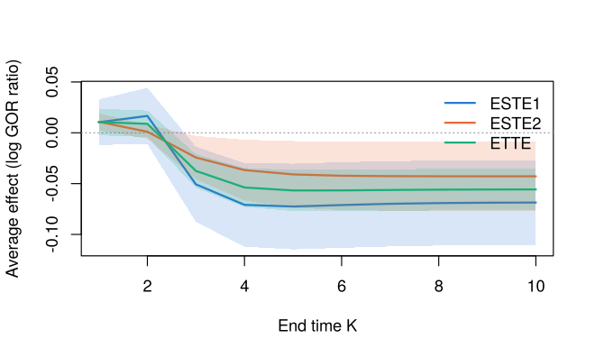

# BiSCaL

**BiSCaL** (Bivariate Separable Causal effects in Longitudinal studies)
estimates and tests causal treatment effects on **two ordinal or binary
responses measured repeatedly over time**. For example, HDL and LDL
cholesterol recorded at every visit of a clinical trial. Responses may
be missing intermittently and follow-up may be censored. The package
implements the methods of Hu and Yi (2026, *Statistics in Medicine*).

The treatment A is conceptualized as two components: A_1 acting on the
first response and A_2 on the second. Effects at the end of follow-up
are defined through generalized odds ratios (GOR) of the two responses:

- the total treatment effect TTE_K compares (A_1, A_2) = (1, 1) with (0,
  0);
- the separable treatment effects STE\_{1,K} and STE\_{2,K} change only
  the component acting on one response, and satisfy STE\_{1,K} +
  STE\_{2,K} = 2\\TTE_K.

The counterfactual arms (1, 0) and (0, 1) are identified by a recursive
formula in the transition probabilities of the responses. `BiSCaL`
estimates these probabilities by maximum likelihood and tests whether
the treatment affects one response more than the other.

## Features

- Maximum likelihood fitting of the transition and baseline models
  (baseline-category logistic regressions), with intermittent
  missingness and right-censoring handled through the observed-data
  likelihood.
- Binary and ordinal responses, with any thresholds of the generalized
  odds ratio.
- Total and separable treatment effects, their absolute values and
  difference, with delta-method standard errors and Wald tests, at given
  covariate values or averaged over a covariate distribution.
- Effects over the course of follow-up, with plots.
- Counterfactual joint distributions and generalized odds ratios under
  any combination of the treatment components.
- Simulators and true values for the simulation designs of the paper.
- Checked against the original research code of the paper: for the
  simulation design with complete data, the estimates, covariance
  matrices, effects and test statistics agree to numerical precision,
  and the effect computations agree with those of the data analysis.

## Installation

Install the development version from GitHub:

``` r

# install.packages("remotes")
remotes::install_github("pingbohu43/BiSCaL", build_vignettes = TRUE)
```

## Example

`simtrial` is a simulated trial with two binary responses, recorded at a
baseline visit and ten follow-up visits, with missingness and censoring.
Fit the models, then estimate the effects for two covariate profiles:

``` r

library(BiSCaL)

fit <- biscal(cbind(y1, y2) ~ x1 + x2, data = simtrial, id = "id",
              time = "visit", treatment = "trt")
summary(fit)$coefficients$beta1      # transition model for y1
#>               Estimate Std. Error   z value     Pr(>|z|)
#> (Intercept) -0.5761739 0.10007335 -5.757516 8.536090e-09
#> y1[k-1]=1    1.5983598 0.09455848 16.903400 4.246953e-64
#> y2[k-1]=1    1.1998988 0.09775178 12.274956 1.234591e-34
#> trt          1.6198973 0.10568903 15.327014 5.046587e-53
#> x1           0.4016786 0.05597743  7.175724 7.192579e-13
#> x2          -0.5472111 0.09367553 -5.841559 5.171467e-09

aste(fit, newdata = data.frame(x1 = c(-1, 1), x2 = c(0, 1)))
#> Separable treatment effects given covariate values (individual level)
#> Thresholds: y1 <= 0, y2 <= 0; Wald 95% confidence intervals
#> 
#> Profile 1 (x1 = -1, x2 = 0), end time K = 10:
#>       Estimate Std. Error Lower 95% Upper 95%
#> STE1  -0.07897    0.02238   -0.1228  -0.03509
#> STE2  -0.03184    0.01304  -0.05739 -0.006276
#> TTE   -0.05540    0.01037  -0.07572  -0.03508
#> ASTE1  0.07897    0.02238   0.03509    0.1228
#> ASTE2  0.03184    0.01304  0.006276   0.05739
#> DASTE  0.04713    0.03021  -0.01207    0.1063
#> H0: DASTE >= 0 vs H1: DASTE < 0: z = 1.560, p-value = 0.941
#> 
#> Profile 2 (x1 = 1, x2 = 1), end time K = 10:
#>       Estimate Std. Error Lower 95% Upper 95%
#> STE1  -0.06218    0.02425   -0.1097  -0.01466
#> STE2  -0.05422    0.02212  -0.09758  -0.01086
#> TTE   -0.05820    0.01221  -0.08214  -0.03426
#> ASTE1  0.06218    0.02425   0.01466    0.1097
#> ASTE2  0.05422    0.02212   0.01086   0.09758
#> DASTE 0.007958    0.03947  -0.06940   0.08532
#> H0: DASTE >= 0 vs H1: DASTE < 0: z = 0.2016, p-value = 0.58
```

Effects averaged over the covariates of the trial participants, and
their evolution over follow-up:

``` r

easte(fit)$effects
#>    K effect    estimate  std.error     conf.low    conf.high        mc_se
#> 1 10  ESTE1 -0.06861868 0.02125479 -0.110277297 -0.026960058 0.0006870910
#> 2 10  ESTE2 -0.04283215 0.01738542 -0.076906951 -0.008757344 0.0002744586
#> 3 10   ETTE -0.05572541 0.01040316 -0.076115223 -0.035335601 0.0003760013
#> 4 10 EASTE1  0.06868117 0.02121616  0.027098257  0.110264077 0.0006808125
#> 5 10 EASTE2  0.04283215 0.01738542  0.008757344  0.076906951 0.0002744586
#> 6 10 DEASTE  0.02584902 0.03275520 -0.038349988  0.090048027 0.0007241223

plot(easte(fit, K = 1:10))
```



## Main functions

| Function | Purpose |
|----|----|
| [`biscal()`](https://pingbohu43.github.io/BiSCaL/reference/biscal.md) | Fit the transition and baseline models by maximum likelihood |
| [`aste()`](https://pingbohu43.github.io/BiSCaL/reference/aste.md) | Separable and total effects, and the test comparing them, given covariate values |
| [`easte()`](https://pingbohu43.github.io/BiSCaL/reference/easte.md) | The same averaged over a covariate distribution |
| [`gor()`](https://pingbohu43.github.io/BiSCaL/reference/gor.md), [`cf_prob()`](https://pingbohu43.github.io/BiSCaL/reference/cf_prob.md) | Generalized odds ratios and counterfactual joint distributions |
| [`simulate_biscal()`](https://pingbohu43.github.io/BiSCaL/reference/simulate_biscal.md), [`biscal_coefs()`](https://pingbohu43.github.io/BiSCaL/reference/biscal_coefs.md), [`biscal_truth()`](https://pingbohu43.github.io/BiSCaL/reference/biscal_truth.md) | Simulation designs of the paper and their true effects |

See
[`vignette("BiSCaL")`](https://pingbohu43.github.io/BiSCaL/articles/BiSCaL.md)
for a worked analysis and
[`vignette("simulation")`](https://pingbohu43.github.io/BiSCaL/articles/simulation.md)
for the simulation studies of the paper reproduced with the package.

## Citation

If you use BiSCaL, please cite the paper (see `citation("BiSCaL")`):

> Hu, P. and Yi, G. Y. (2026). Inference about separable causal effects
> with longitudinal bivariate ordinal responses with missingness and
> censoring. *Statistics in Medicine*, 45, e70320.
> [doi:10.1002/sim.70320](https://doi.org/10.1002/sim.70320)

## License

GPL (\>= 3)
